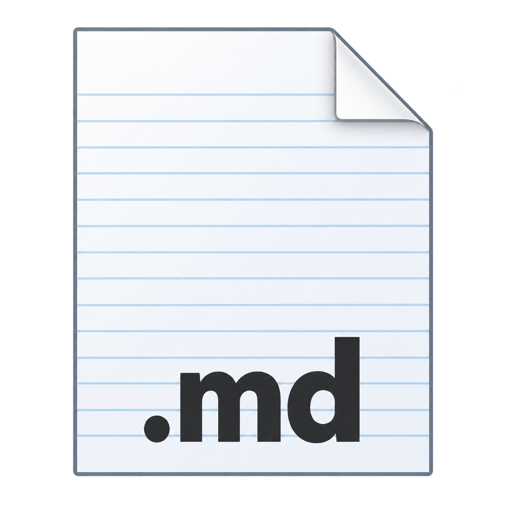
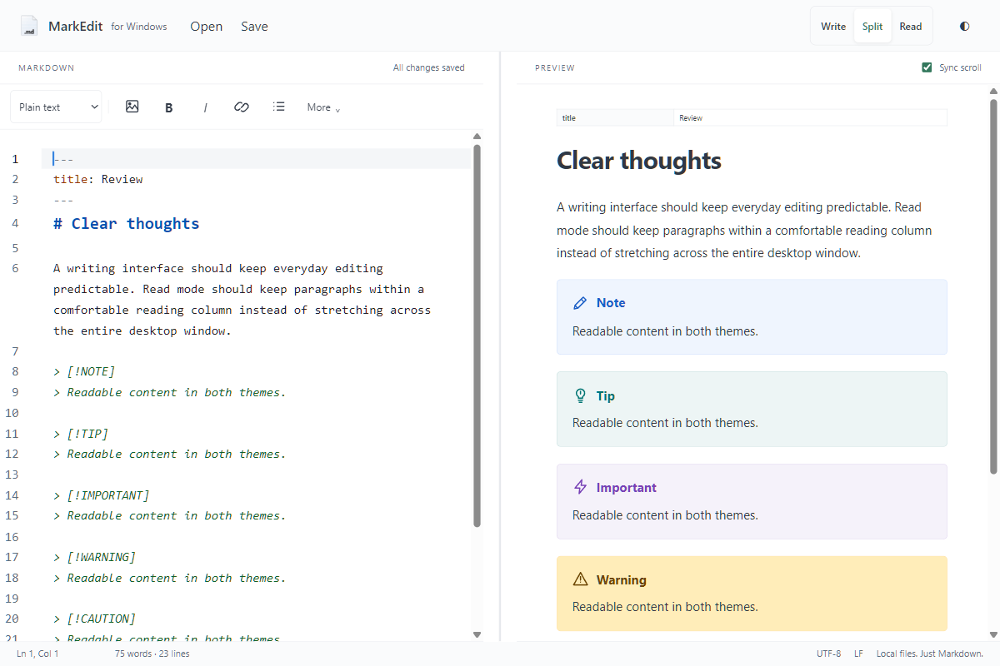
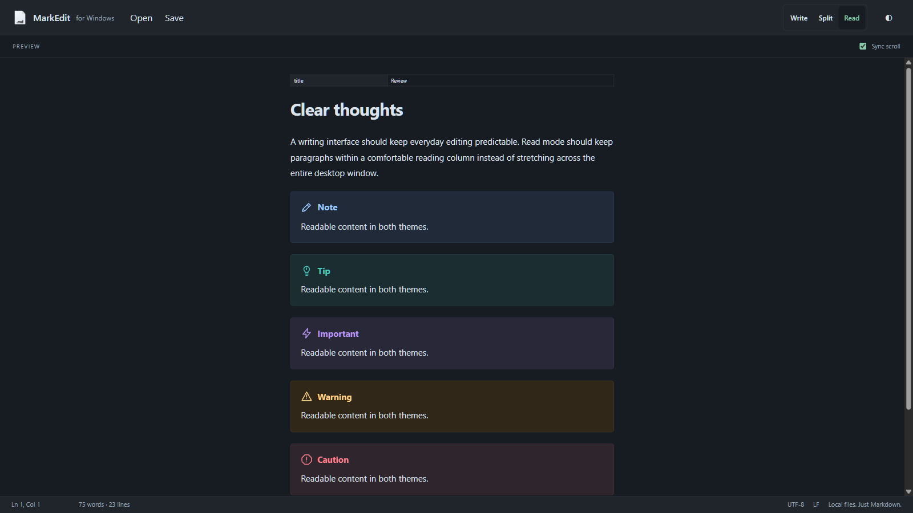

<p align="center">
  
</p>

# MarkEdit for Windows

A free and open-source Markdown editor for Windows. Write, preview, and read your local Markdown files in a simple desktop app.

Inspired by **[MarkEdit](https://github.com/MarkEdit-app/MarkEdit)** for macOS. This independent Windows adaptation reuses its MIT-licensed CodeMirror editor, with a Rust and Tauri desktop shell.

## Preview



<details>
<summary>Dark mode</summary>



</details>

## Features

- Write, Split, and Read layouts, with light and dark themes.
- Live preview for Markdown, tables, task lists, callouts, and Mermaid diagrams.
- Standalone HTML and PDF export, with embedded local images and diagrams.
- Image insertion by file selection, clipboard paste, or drag and drop.
- Keyboard shortcuts, find and replace, and undo/redo.
- H1-based filename suggestions and a compact YAML frontmatter table.
- Local files, explicit saves, and no account required.

## Installation

Download the **Windows x64 ZIP** from the **[latest release](https://github.com/gregomuraca/markedit-windows/releases/latest)**, extract it, and open **`MarkEdit.exe`**.

Requires **Windows 10 or 11, x64**, and the [Microsoft Edge WebView2 Runtime](https://developer.microsoft.com/microsoft-edge/webview2/). No Node.js or Rust installation is needed for the portable app. The executable is currently unsigned; use the downloads from this repository. Release checksums are included in `SHA256SUMS.txt`.

<details>
<summary>Optional npx installation</summary>

With Node.js 20 or newer:

```powershell
npx --yes https://github.com/gregomuraca/markedit-windows/releases/download/v0.4.0/markedit-windows-launcher-0.4.0.tgz
```

The small launcher verifies and installs the Windows release in your user profile, creates a Start menu shortcut, and opens the app. It is hosted on GitHub, not the npm registry. Use `--install-only` to skip opening the app, or `--help` for options. [Installer source](launcher/install.ps1).

</details>

To update a portable copy, close MarkEdit and replace its app files with the new release. Keep your Markdown documents and their `assets` folders together.

## Using MarkEdit

Open a Markdown file with **Ctrl+O**, save with **Ctrl+S**, or start a new document with **Ctrl+N**. Use **Ctrl+B** for bold, **Ctrl+I** for italic, **Ctrl+1–6** for headings, and **Ctrl+F** for find and replace.

Images are copied to an `assets` folder beside the document. Saving a new document or choosing Save As suggests a filename from its first H1.

Saving a copy into another folder also copies its referenced local images, preserving their relative paths. Identical images already there are reused; a different image at the same path stops the save so it cannot be overwritten. The original document and images remain in place. Images that were already unavailable remain labeled in the preview.

Choose **Export → HTML… or PDF…** in the toolbar or **File → Export** to export the current draft. HTML files include their styles, local images and diagrams for offline viewing. PDFs use a light A4 layout. Exporting leaves your Markdown file and unsaved changes untouched; missing images or invalid diagrams remain labeled in the output.

The preview supports GFM tables and alignment, task lists, strikethrough, autolinks and fenced code, plus GitHub-style alerts. Active HTML is sanitized; remote images are not fetched. It does not reproduce every GitHub rendering behavior.

The app uses explicit saves. Autosave, crash recovery, tabs and math rendering are not included. Files and images can be up to 20 MB; live preview and export support up to one million characters. Exported documents can be up to 64 MB.

## Contributing

For bugs or focused improvements, [open an issue](https://github.com/gregomuraca/markedit-windows/issues) or a pull request. Please keep changes focused on a simple Windows Markdown editor.

See [development instructions](DEVELOPMENT.md) to build and test the app.

## License and acknowledgments

Released under the **[MIT License](LICENSE)**. The original MarkEdit copyright and license notice are preserved. Dependencies retain their own licenses; see [third-party notices](THIRD-PARTY-NOTICES.txt).

Thanks to **[MarkEdit](https://github.com/MarkEdit-app/MarkEdit)** and **[CodeMirror 6](https://codemirror.net/)**. This is a community Windows project, not an official release from the MarkEdit team.
